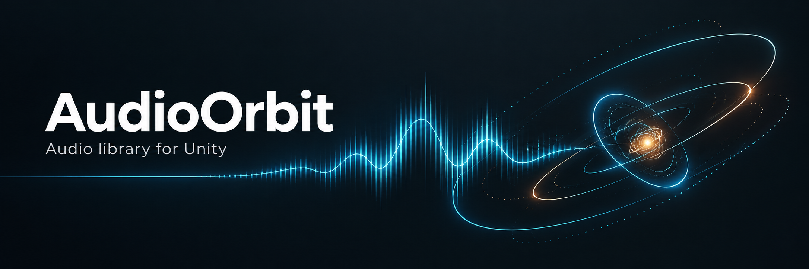
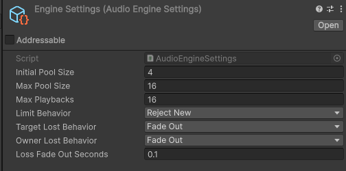
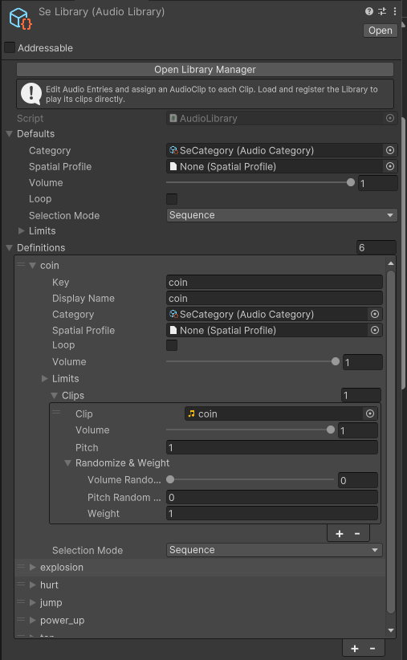
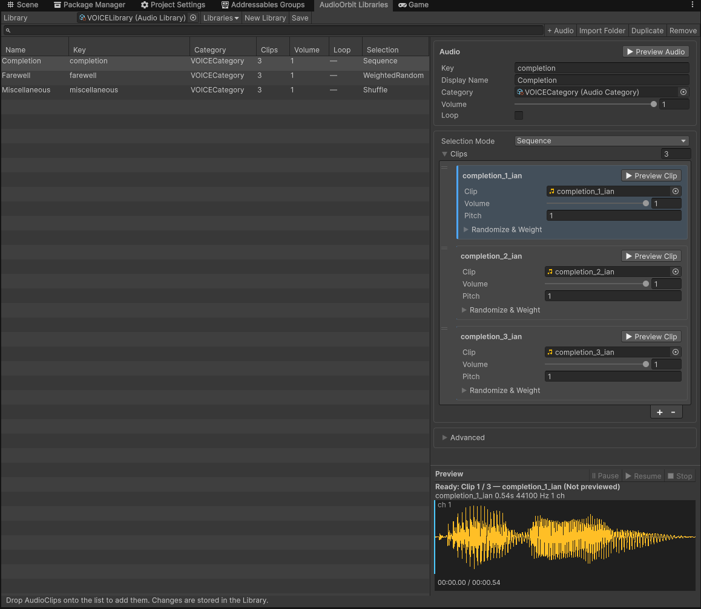
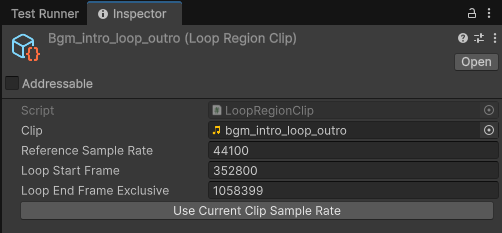
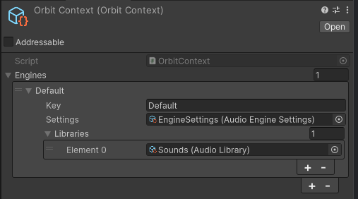
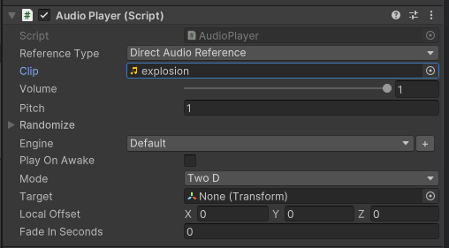

# AudioOrbit

日本語 | [English](README.md)

Unity 2022.3以降向けのオーディオライブラリです。SE・VOICE・BGMをLibraryにまとめ、再生・事前ロード・フェード・終了待機を共通のAPIで扱います。


## インストール

UnityのPackage Managerで **Add package from git URL** を選び、次の形式で指定します。

```text
https://github.com/kurobon-jp/AudioOrbit.git?path=Packages/com.github.kurobon.audioorbit/
```

対応バージョンは**Unity 2022.3以降**です。LoopRegionClipとGeneratorによる再生のみ**Unity 6.3以降**が必要です。

## データ構成

| 型 | 役割 |
|---|---|
| AudioEngineSettings | AudioSourceプール、全体の再生制限、Owner・追従先（Target）消失時の動作 |
| AudioLibrary | Audio（再生定義）群と、新規Audio用のデフォルト設定を保存するアセット |
| AudioDefinition | Key、表示名、Category、Volume、Loop、選択方式、制限、Clips |
| ClipDefinition | 候補音源、Volume、Pitch、ランダム幅、Weight |
| AudioCategory | カテゴリー音量、再生制限、AudioMixerGroupなど |
| SpatialProfile | 距離減衰などの空間再生設定 |
| PlaybackHandle | 再生・停止の操作と状態通知を担うハンドル。再利用して繰り返し再生できる |

本書では、AudioLibraryに保存される再生定義（AudioDefinition）を「Audio」と呼びます。

## EngineSettings

AudioEngineSettingsは、Engine全体の再生上限、AudioSourceプール、Target／Ownerが消失したときの動作を設定するScriptableObjectです。

`Assets > Create > AudioOrbit > Engine Settings`で作成し、`new AudioEngine(settings)`に渡します。



| 設定 | 内容 | 初期値 |
|---|---|---|
| Initial Pool Size | Engine生成時に用意するAudioSource数 | 16 |
| Max Pool Size | Engineが作成するAudioSource数の上限。プールは必要に応じて拡張されます | 64 |
| Max Playbacks | Engine全体の同時再生数の上限 | 64 |
| Limit Behavior | 再生上限に達した場合の動作。Reject New（新規再生を拒否）、Stop Oldest（最も古い再生を停止）、Stop Lowest Priority（優先度が最も低い再生を停止） | Reject New |
| Target Lost Behavior | 追従先（Target）のTransform消失時の動作。Stop、Fade Out、Keep Last Position（最後の位置で継続） | Fade Out |
| Owner Lost Behavior | Owner消失時の動作。Stop、Fade Out、Continue（再生を継続） | Fade Out |
| Loss Fade Out Seconds | Target／Owner消失時にFade Outを選んだ場合のフェード時間（秒） | 0.1 |

Initial Pool SizeはMax Pool Size以下に設定します。Target／Owner消失時の設定は`PlayOptions`で再生ごとに上書きできます。各音源のVolumeやLoop、CategoryはAudioLibrary側で設定します。

## AudioLibrary

AudioLibraryは、SE・VOICE・BGMなどの再生定義をまとめて保存するScriptableObjectアセットです。各AudioDefinitionにKey、音量、ループ、カテゴリー、候補となるClipを設定します。1つの定義に複数のClipを登録すると、順番や重み付きランダムなどのルールで音源を選べます。

Libraryは用途やロードする単位に合わせて分けられます。直接Engineに登録するほか、ResourcesやAddressablesからロードでき、コードからはKeyや参照を使って再生します。

`Assets > Create > AudioOrbit > Audio Library`で作成し、AudioLibraryWindowで内容を編集します。



AudioDefinitionとClipDefinitionはLibrary内に保存するシリアライズデータです。音源ごとのScriptableObjectは不要です。通常のClipにはAudioClipを設定します。Unity 6.3以降ではLoopRegionClipなどのIAudioGeneratorも設定できます。

## 最初の再生

1. `Assets > Create > AudioOrbit > Engine Settings`で設定を作成します。
2. `Assets > Create > AudioOrbit > Audio Library`でLibraryを作成します。
3. `Window > AudioOrbit > Library Manager`でLibraryを選び、AudioClipを一覧にドロップします。
4. AudioのKeyを`attack`に設定し、次のコンポーネントへアセットを割り当てます。

```csharp
using AudioOrbit;
using UnityEngine;

public sealed class AudioExample : MonoBehaviour
{
    [SerializeField] private AudioEngineSettings settings;
    [SerializeField] private AudioLibrary library;
    private AudioEngine engine;
    private PlaybackHandle attack;

    private void Awake()
    {
        engine = new AudioEngine(settings);
        engine.RegisterLibrary(library);
        attack = engine.CreatePlayback("attack");
        attack.StateChanged += (_, state) => Debug.Log(state);
    }

    public void PlayAttack()
    {
        attack.Play();
    }

    private void OnDestroy()
    {
        attack?.Dispose();
        engine?.Dispose();
    }
}
```

シーンにはAudioListenerが必要です。オプション省略時は2D再生で、Volume・Loop・Clip選択はAudioの設定を使います。Engineの操作はUnityメインスレッドで行ってください。

## PlaybackHandleの操作

`CreatePlayback()`で作成したHandleを保持し、入力やイベントから再生・停止を操作します。

次の例は、初期化済みの`engine`を使うコンポーネントの抜粋です。`PlayAttack()`と`StopAttack()`は、それぞれ別の入力やイベントから呼び出します。

```csharp
private PlaybackHandle playback;

private void Awake()
{
    playback = engine.CreatePlayback("attack");
    playback.StateChanged += (handle, state) => Debug.Log(state);
}

// 再生ボタンや攻撃イベントから呼び出す。
public void PlayAttack() => playback.Play();

// 停止ボタンなど、再生を止めたいイベントから呼び出す。
public void StopAttack() => playback.Stop(fadeSeconds: 0.2f);
```

`Play()`と`Stop()`は直ちに戻り、ロードやフェードはEngineが進めます。同じHandleで再度`Play()`を呼ぶと、ロード待ちやフェード停止中であっても、現在の再生を即時停止して新しい再生を開始します。音を重ねる場合は複数のHandleを使います。Handleは所有者の破棄時に`Dispose()`すると、再生も停止します。

### 状態の監視

作成直後のHandleの状態は`Idle`です。状態の変化は`playback.StateChanged += OnStateChanged;`で受け取れます。コールバックの引数は`(PlaybackHandle handle, PlaybackState state)`です。

- 状態が変わったときだけ、Unityメインスレッドへ通知をキューイングし、発生順に届けます。
- Ended通知の前に終了結果を確定します。
- 購読者の例外はログに記録し、他の通知は継続します。
- 過去の遷移は再通知しません。購読直後のUI表示には`playback.State`も参照してください。即時再生では、購読前にPlayingが発生していることがあります。
- 通知には発生時の状態を渡します。通知を受け取る時点で、現在の`State`が先に進んでいる場合があります。

### Engineの一括停止

EngineにはStopAll・StopCategory・StopOwner・StopLibraryと、それぞれのAsync版があります。フェードには非スケール時間を使います。

## AudioLibraryLoader

`IAudioLibraryLoader`はLibraryのロード方法を担当します。Loaderを`engine.PreloadAsync(loader, token)`に渡すと、ロードしたLibraryがEngineに登録・キャッシュされ、その中のKeyを`CreatePlayback("voice_attack")`へ指定できます。Loader自体には、再生するAudioのKeyを持たせません。

### Resourcesからロード

```csharp
var loader = ResourcesAudioLibraryLoader.FromPath("Audio/VoiceLibrary");
await engine.PreloadAsync(loader, token);
var playback = engine.CreatePlayback("voice_attack");
playback.Play();
```

Resourcesからの相対パスで指定したLibrary全体をロードします。例：`Assets/Game/Resources/Audio/VoiceLibrary.asset`

### Addressables：addressまたはlabel

```csharp
using AudioOrbit.Addressables;

var loader = AddressablesAudioLibraryLoader.FromKey("audio/voice/character01");
await engine.PreloadAsync(loader, token);
var playback = engine.CreatePlayback("voice_attack");
playback.Play();
```

`FromKey`にはaddressまたはlabelを指定できます。labelを指定すると、複数のLibraryをまとめてロードできます。

### Loaderの所有とキャッシュの解放

- `PreloadAsync(loader, token)`へ直接渡したLoaderは、呼び出し側が`Dispose()`します。
- Loaderのキャッシュと同時ロードは共有されます。Loaderを`Dispose()`するとLoader自身のキャッシュを解放し、既存のリースは最後の利用まで維持されます。
- Engineのキャッシュは、再生終了では解放されません。`engine.ReleaseLibrary(loader)`またはEngineの`Dispose()`で解放します。
- `CreatePlayback(string key)`は、登録済みLibraryのKeyを使用します。

## LibraryReference

`IAudioLibraryReference`はロードするLibraryの所在を表します。Resources版はパス、Addressables版はAssetReferenceを保持します。

```csharp
var libraryReference = new ResourcesLibraryReference { LibraryPath = "Audio/VoiceLibrary" };
await engine.PreloadAsync(libraryReference, token);
// Libraryのキャッシュが不要になったとき
engine.ReleaseLibrary(libraryReference);
```

## AudioReference

`IAudioReference`は再生対象を保持する参照です。Libraryのロード情報とAudioのKeyをまとめたResources／Addressables参照なら、`engine.CreatePlayback(reference)`から`Play()`するだけで、未ロードのLibraryも自動ロードします。ResourcesAudioReference／AddressablesAudioReferenceは`IAudioReference`を実装し、Library参照とAudioのKeyを保持します。Library参照が作成したLoaderはEngineが管理します。

Engine Audio Referenceは登録済みKey、Direct Audio ReferenceはClipを直接参照するため、Libraryの自動ロードは行いません。

`IAudioReference`は再生対象の共通型です。`IAudioLibraryReference`は継承関係のない独立した型で、Libraryの所在とLoaderの作成だけを担当し、AudioのKeyは持ちません。`PreloadAsync(libraryReference)`はLibrary参照を受け取り、Library全体を保持します。

### 参照とキャッシュ

- 事前ロードは必須ではありません。未ロードなら、Libraryをロードしてから発音します。発音時のロード待ちを避けたい場合だけ、準備処理で`await engine.PreloadAsync(reference.LibraryReference, token)`を使用します。
- `PreloadAsync(reference.LibraryReference)`は、再生対象のKeyとは独立してLibrary全体をEngineにキャッシュします。
- 自動ロード・事前ロードのどちらも、キャッシュは再生終了では解放されません。`engine.ReleaseLibrary(reference.LibraryReference)`またはEngineの`Dispose()`で解放します。明示的に解放しても、再生中の音源は終了まで保持します。
- 同時リクエストはロードを共有します。LibraryはEngineのキャッシュと再生が保持します。
- `CreatePlayback("attack")`は登録済みLibraryのKeyを使用します。`CreatePlayback(reference)`は、再生時のLibrary自動ロードにも対応します。

### Resources参照

`ResourcesAudioReference`は、`ResourcesLibraryReference`型のLibraryとAudioのKeyを保持します。Resources相対パスはLibrary側に設定します。Inspectorでは、Library、Audio候補、Library Managerを開くボタンを表示します。

```csharp
private ResourcesAudioReference reference = new ResourcesAudioReference
{
    Library = new ResourcesLibraryReference { LibraryPath = "Audio/VoiceLibrary" },
    Key = "voice_attack"
};

// 最初の例のAwakeで、RegisterLibraryとCreatePlayback("attack")の代わりに使用。
attack = engine.CreatePlayback(reference);
```

Libraryは、例えば`Assets/Game/Resources/Audio/VoiceLibrary.asset`に配置します。`PlayAttack()`と破棄処理は最初の例と同じです。

`[SerializeReference] private IAudioLibraryReference library;`ではLibraryだけを設定します。ResourcesLibraryReference／AddressablesLibraryReferenceを選べ、Audioの選択欄はありません。再生対象を設定する場合は`IAudioReference`を使用します。配列にも対応します。

Resources版は、リース終了時に参照を解放します。ネイティブメモリの回収は、Unityの不要アセット解放に従います。他の利用者に影響する`Resources.UnloadAsset`は呼びません。Resources内のパスは重複させないでください。

### Addressablesから再生

Library自体をAddressableに登録します。ClipはLibraryの依存アセットとしてロードされます。Resources版はCoreの`ResourcesAudioReference`を使用します。

```csharp
using AudioOrbit.Addressables;

[SerializeField] private AddressablesAudioReference attackReference;

// 最初の例のAwakeで、RegisterLibraryとCreatePlayback("attack")の代わりに使用。
attack = engine.CreatePlayback(attackReference);
```

`PlayAttack()`と破棄時の処理は最初の例と同じです。未ロードのLibraryは、再生時に自動でロードされます。発音時のロード待ちを避けるには、準備処理で事前ロードします。

```csharp
await engine.PreloadAsync(attackReference.Library, token);
```

InspectorではAddressable登録済みのLibraryとAudioを選択します。Openボタンで、Library Managerの該当Audioを開きます。Library参照にはAssetReferenceを、再生参照にはLibrary参照とKeyを保存します。LibraryのGUIDをAddressablesカタログに含めてください。

### Clipの直接再生

Libraryを用意せず、AudioClipまたはClipDefinitionを直接再生できます。

```csharp
var playback = engine.CreatePlayback(new DirectAudioReference(audioClip));
playback.Play();
```

同じ`DirectAudioReference`から複数のHandleを作成し、同時に再生できます。各再生はVolumeやPitchなどの設定を個別に保持し、AudioClipは共有します。

- Direct参照は未分類のCategoryを使用し、全体の再生数制限を適用します。
- SpatialProfileは`PlayOptions`で指定できます。未指定時は標準の空間設定を使用します。
- 単一Clipなので、Weightは使用しません。
- LoopRegionClipは、ClipDefinitionのGeneratorに指定できます（Unity 6.3以降）。
- アセットの読み込みと保持は、呼び出し側が管理します。

AudioPlayerのReference TypeでDirect Audio Referenceを選ぶと、Inspectorで設定できます。

### 独自のバックエンド

独自のLibraryバックエンドは、`IAudioLibraryReference`と`IAudioLibraryLoader`で実装できます。再生参照は`IAudioReference`を実装し、`Key`で再生対象、`LibraryReference`でそのLibrary参照を返します。直接Clipまたは登録済みKeyを再生する参照は、LibraryReferenceにnullを返します。Library参照が作成したLoaderはEngineが所有します。`PreloadAsync(loader)`へ直接渡したLoaderは、呼び出し側が所有します。

## 再生と停止

```csharp
var options = PlayOptions.TwoD();
options.FadeInSeconds = 0.5f;
var playback = engine.CreatePlayback("bgm_battle");
playback.Play(options);

playback.Pause();
playback.Resume();
playback.Stop(fadeSeconds: 1f);
```

### 再生終了と停止の待機

`PlayAsync`は、再生を開始して終了まで待ちます。Tokenをキャンセルすると、その呼び出しが開始した再生やロード待ちも停止します。`WaitForCompletionAsync`は開始済みの再生を待つAPIで、Tokenは待機だけを取り消します。

```csharp
var result = await playback.PlayAsync(token);
// 再生オプションを指定する場合
var nextResult = await playback.PlayAsync(options, token);
```

- キャンセル時は`OperationCanceledException`で終了します。
- キャンセル済みのTokenでは、再生を開始せず、既存の再生も変更しません。
- Handleを再利用した後に古いTokenがキャンセルされても、新しい再生は停止しません。
- 共有Libraryのロードと、Engineのキャッシュは維持します。

ボイス終了後に会話を進める場合は`WaitForCompletionAsync()`、フェード停止後に次の処理へ進む場合は`StopAsync()`を使います。

```csharp
// 非同期メソッド内で、再生終了まで待つ例。
using var playback = engine.CreatePlayback("attack");
playback.Play();
var result = await playback.WaitForCompletionAsync(token);
```

```csharp
// 再生中のHandleをフェード停止し、その完了を待つ例。
await playback.StopAsync(fadeSeconds: 1f, cancellationToken: token);
```

`using var`はメソッド終了時にHandleを解放し、再生を停止します。イベント間で再生を続ける場合は、最初の例のようにフィールドで保持します。

開始済みの待機は、呼び出し時点の再生を対象にします。Handleを再利用しても、待機対象は変わりません。

#### PlaybackHandleのAPI

| API | 動作 |
|---|---|
| `Play(...)` | 再生を開始する。戻り値はvoid。ロード中も同じHandleで停止できる |
| `PlayAsync(options, token)` | 再生を開始して終了まで待機する。Tokenで、その再生も停止する |
| `WaitForCompletionAsync(token)` | ロード待ちから再生終了・失敗まで待機する |
| `Stop(fadeSeconds)` | 停止を要求する。戻り値はvoid |
| `StopAsync(fadeSeconds, token)` | 停止を要求し、停止完了まで待機する |

#### EngineのAPI

| API | 動作 |
|---|---|
| `PreloadAsync(...)` | ロード完了を待ち、Engineにキャッシュする |
| `ReleaseLibrary(...)` | Libraryのキャッシュを解放する。再生中の音源は終了まで保持する |

Handle自体はawaitできません。`Play`は`CancellationToken`を受け取りません。再生をキャンセルするには、`Stop`を呼ぶか、`PlayAsync`に渡したTokenを使います。`WaitForCompletionAsync`と`StopAsync`のTokenは待機のみを取り消し、再生や要求済みのフェード停止は継続します。

### フェードと位置指定

FadeInSecondsは開始時に音量を上げる時間、Stopの`fadeSeconds`は停止時に音量を下げる時間です。クロスフェードは、新曲のフェードインと旧曲のフェードアウトを重ねます。

位置を指定するには`PlayOptions.At(position)`、Transformに追従させるには`PlayOptions.Attached(transform)`を使用します。

## AudioLibraryWindow

AudioLibraryWindowは、Library内の再生定義を一覧で管理する編集ウィンドウです。`Window > AudioOrbit > Library Manager`から開きます。

1. 編集するLibraryを選びます。New Libraryから新規作成もできます。
2. AudioClipを一覧にドロップするか、Import FolderでProject内のフォルダから取り込みます。+ Audioでは空の定義を追加できます。
3. 一覧で定義を選び、Keyや再生設定、候補Clipを編集します。検索やカラムのソートで対象を探し、Duplicate／Removeで複製・削除できます。
4. Preview AudioやPreview Clipで試聴し、Saveで変更を保存します。



- **Audio**：Key、Display Name、Category、Volume、Loopなどを設定します。
- **Clips**：候補音源と、Volume・Pitch・ランダム幅・Weightを設定します。
- **Selection Mode**：Sequence（初期値）、Weighted Random、Avoid Immediate Repeat、Shuffleから選択します。
- **New Audio Defaults**：新規追加するAudioの初期設定です。詳細は後述します。
- **Import Folder**：Project内のAudioClipを取り込みます。外部ファイルはコピーせず、既にLibraryが参照するClipはスキップします。

Preview Audioでは選択ルールを含む再生を確認でき、Preview Clipでは各音源を個別に確認できます。波形はチャンネルごとに表示され、クリック・ドラッグでシークできます。編集はUndoに対応し、変更はまとめてUndoできます。内容はLibrary内に保存され、Save操作で保存します。

Keyは大文字・小文字を区別する文字列です。空欄と、他Libraryを含む重複を編集時に検証し、登録時にも拒否します。Clip未設定などの不完全なAudioは、そのAudioの再生時に失敗しますが、他のAudioの再生は妨げません。

| Selection Mode | 選択方法 |
|---|---|
| Sequence（初期値） | リスト順に再生し、末尾から先頭に戻る |
| Weighted Random | Weightに従う抽選 |
| Avoid Immediate Repeat | 直前のClipを避ける重み付き抽選 |
| Shuffle | 候補を並べ替えて再生 |

Weightが0のClipは選択対象外です。EditorのPreview Clipは選択ルールを使わず、指定したClipを試聴します。

### New Audio Defaults

New Audio Defaultsには、Category、Spatial Profile、Volume、Loop、Selection Mode、再生数制限とクールダウンを設定できます。

- Audioの追加・ドロップ・フォルダ取り込み時にコピーします。既存のAudioには遡って適用しません。
- 制限設定は、Audioごとにコピーされます。
- Duplicateは、元のAudioの設定を保持します。

コードからは次のように追加できます。

```csharp
var audio = library.CreateAudio(); // デフォルトをコピー。まだ追加されない
audio.Key = "attack";
audio.DisplayName = "Attack";
audio.Clips.Add(new ClipDefinition { Clip = audioClip });
library.Entries.Add(audio);
```

## イントロ・ループ・アウトロ

**Unity 6.3以降限定**です。旧バージョンでは、LoopRegionClipとGenerator APIをコンパイルせず、InspectorのClip候補はAudioClipのみになります。



### 作成と設定

`Assets > Create > AudioOrbit > Loop Region Clip`で独立したアセットを作り、AudioClipとLoop Start Frame・Loop End Frame Exclusiveを設定します。AudioのClipに、そのアセットを割り当てます。

区間はサンプルフレーム単位の`[start, end)`です。Loopが有効なら、イントロから区間へ入り、区間を繰り返します。

### Reference Sample Rate

LoopRegionClipのReference Sample Rateには、Loop Start FrameとLoop End Frame Exclusiveを設定したときのサンプルレートを保存します。実行時は`Clip.frequency`に合わせて両端を補正し、変換後の範囲を検証します。

- 新規作成直後は、Clipを割り当てると基準レートが初期化されます。以後のインポート設定の変更では上書きしません。
- 既存アセットで値が未設定の場合は警告されます。設定時のレートを確認して入力してください。
- Use Current Clip Sample Rateは、保存済みのフレーム位置が、現在のClipのレートを基準にしている場合に使います。
- スクリプトで作成する場合も、`ReferenceSampleRate`を指定してください。

### 再生例

次の例は、初期化済みの`engine`を使うコンポーネントの抜粋です。BGM開始時に`PlayBgm()`、アウトロへ移行するイベントで`PlayOutro()`を呼び出します。Handleの破棄は初期化の例と同様に行います。

```csharp
private PlaybackHandle bgm;

private void Awake()
{
    bgm = engine.CreatePlayback("bgm_battle");
}

// BGMの開始イベントから呼び出す。
public void PlayBgm()
{
    var options = PlayOptions.TwoD();
    options.Loop = true;
    bgm.Play(options);
}

// 別のイベントから呼び出し、区間末尾を経てアウトロへ進む。
public void PlayOutro() => bgm.Loop = false;
```

再生中に`PlaybackHandle.Loop`を`false`にすると、ループを終了し、区間末尾を経てアウトロへ進みます。

### 制約とメモリ

1つのAudioSourceで、DSP側が境界を処理します。同一アセットを同時に再生しても再生状態は独立し、PCMは共有します。既に出力キューへ送られたバッファには、操作が遡って反映されません。

元のAudioClipのImport Settingsで、**Load TypeをDecompress On Loadに設定してください**。LoopRegionClipは、Compressed In MemoryとStreamingに対応していません。音源はモノラルまたはステレオ、Pitchは正の値（通常は`1`）である必要があります。通常のAudioClip再生では、Compressed In MemoryとStreamingも利用できます。

区間再生のため、音源全体のデコード済みfloat PCMを追加でコピーして保持します。追加メモリの目安は`秒数 × サンプルレート × チャンネル数 × 4バイト`です。48kHz・ステレオ・3分なら約66MiBで、初回コピー時には、さらに同程度の一時配列を確保します。同じAudioClipを同時に再生する場合、PCMコピーは共有します。

## 外部AudioSource

```csharp
var source = engine.RegisterExternalSource(audioSource);
var playback = engine.CreatePlayback(source);
playback.Play();
```

AudioSourceに設定されたClipを再生できます。登録中はAudioOrbitが制御するため、`playOnAwake`は無効にしてください。`ExternalSourceOptions.Key`は任意です。未指定なら、登録ごとに制限を管理します。Keyを指定すると、同じKeyの再生と制限・クールダウンを共有します。

## OrbitContext

OrbitContextは、複数のコンポーネントから共有するAudioEngineの設定と寿命を管理するScriptableObjectです。利用側でEngineを生成・保持する代わりに、`OrbitContext.Get()`で既定のEngine、`OrbitContext.Get("BGM")`で指定したKeyのEngineを取得できます。同じKeyなら、呼び出し元に関係なく同じEngineを返します。



各Engine定義には、次の項目を設定します。

| 設定 | 内容 |
|---|---|
| Key | Engineを識別する文字列。既定値は`Default`。AudioのKeyとは別の識別子です |
| Settings | そのEngineに使用するAudioEngineSettings |
| Libraries | Engine生成時に直接登録するAudioLibrary。Resources／Addressables参照だけを使う場合などは省略できます |

`Get`は初回アクセス時にEngineを作成し、Librariesを登録します。`TryGet(key, out engine)`は作成済みのEngineだけを取得し、新しく生成しません。共有Engineの破棄はContextが担当するため、利用する各コンポーネントからEngineを`Dispose()`しないでください。各コンポーネントが作成したPlaybackHandleは、そのコンポーネントで管理します。

OrbitContextは任意です。Engineを自分で所有する場合は、最初の再生例のように`new AudioEngine(settings)`で生成し、所有者が`Dispose()`します。AudioPlayerは、OrbitContextに設定されたEngineを使用します。

**ロードと登録**

- ContextはPreloaded Assetsでロードされます。実行時は`OnEnable`でinstanceを登録し、別のContextによる上書きを拒否します。
- 実行中にContextを検索することはありません。
- Editorでは、Preloaded Assetsに登録した1つだけがinstanceを設定します。非再生時のEditorプレビューに限り、未登録ならPreloaded Assetsから取得します。

**Engineの管理**

- 登録済みKeyのEngineだけを、遅延生成します。
- Keyごとに、Settingsと直接登録するLibrariesが独立します。
- Engineごとに、プール・再生制限・一括停止・Libraryのロード状態が独立します。
- 空欄・重複したKeyはInspectorでエラー表示します。未定義KeyのGetは例外になります。
- PlayerのEngine Keyは、登録済みの候補から選択できます。

**破棄**

- アプリ終了時とContext解放時に、全Engineを破棄します。

**Editorでの再生**

- Editorの非再生時も、`OrbitContext.Get()`から再生できます。専用のPreview SceneとEditorの時刻で更新し、自然終了・フェード・クールダウンを処理します。
- Play Modeの開始／終了、スクリプトの再読み込み、Editorの終了時に、プレビュー用のリソースを解放します。
- AudioPlayerの自動再生はPlay Modeに限定します。非再生時は、明示的にPlayを呼んでください。

## AudioPlayerによる自動再生

1. `Create > AudioOrbit > Orbit Context`でContext ScriptableObjectを作成し、InspectorのAssignボタンでPreloaded Assetsへ登録します。Contextは1つだけ登録してください。
2. ContextのEnginesに、Key・Settings・Librariesを設定します。Librariesは任意です。
3. 再生対象にAudioPlayerを追加し、Engineを選択します。既定値は`Default`です。同じKeyなら同じEngine、異なるKeyなら別のEngineを使用します。Keyは大文字・小文字を区別します。
4. Reference Typeを選び、次の表に従ってReferenceを設定します。
5. Play On Awakeが有効なら、Play Modeでコンポーネントが有効になるたびに自動再生します。



| Reference Type | 設定と動作 |
|---|---|
| Engine Audio Reference | Keyをテキスト入力します。選択したEngineに登録済みのAudioのKeyを指定します。 |
| Direct Audio Reference | AudioClipを直接設定します。 |
| Resources Audio Reference | Resourcesフォルダ内のLibraryとAudioを選択します。未ロードのLibraryは再生時に自動ロードします。 |
| Addressables Audio Reference | Addressable登録済みのLibraryとAudioを選択します。未ロードのLibraryは再生時に自動ロードします。 |

Engine Audio Referenceを使う場合は、OrbitContextのEngine設定またはコードから、再生前にLibraryを登録してください。InspectorではKeyの入力を制限せず、存在確認は再生時に行います。

Playerを無効化すると、そのPlayer自身の再生とロード待ちだけを停止します。`Play()`を再度呼ぶと、前回の自分の再生を停止して再生し直します。

```csharp
var engine = OrbitContext.Get();
var bgm = OrbitContext.Get("BGM"); // ContextにBGM定義を作成した場合
await engine.PreloadAsync(reference.LibraryReference, token);
var playback = engine.CreatePlayback(reference);
playback.Play();
await playback.StopAsync(fadeSeconds: 0.5f, cancellationToken: token);

// Engineを生成せず、既存のものだけを操作する。
if (OrbitContext.TryGet("BGM", out var existing)) existing.StopAll();
```

PlayerのModeは、TwoD／AtPosition／Attachedから選びます。OwnerはPlayer自身です。現在のHandleは、Playbackから取得できます。Fade In Secondsは開始時のフェード、Stop／StopAsyncの引数は停止時のフェードです。
